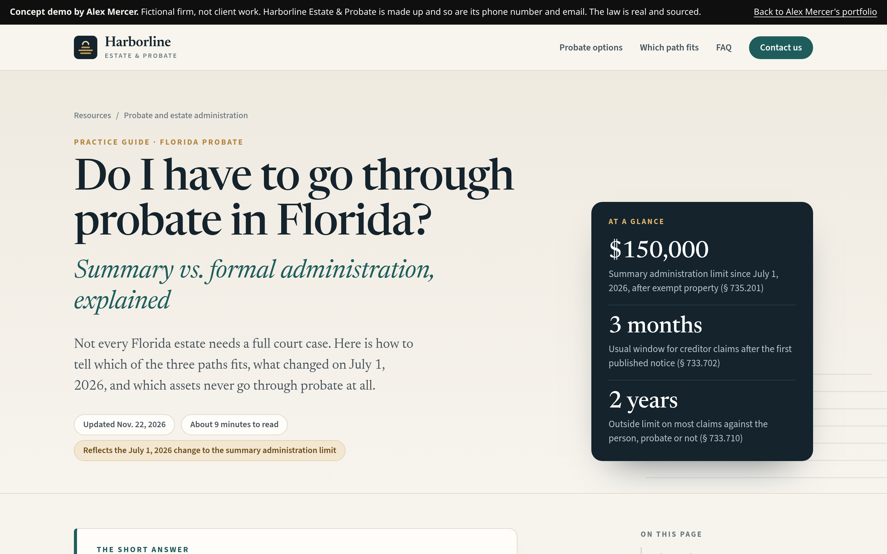

# Harborline Estate & Probate: Florida probate explainer (concept demo)

A plain-English practice-area article for a made-up Florida estate and probate firm: **"Do I have to go through probate in Florida? Summary vs. formal administration, explained."**

**Live page:** https://alexmercerprojects.com/harborline-florida-probate-explainer/
**PDF:** [docs/harborline-florida-probate-guide-DEMO.pdf](docs/harborline-florida-probate-guide-DEMO.pdf)

> Concept demo by Alex Mercer. Harborline Estate & Probate is not a real firm, the phone number and email are placeholders, and this is not client work. The law it describes is real and every point is sourced. It is general information, not legal advice, and it has not been reviewed by a Florida-licensed attorney.



## What's in it

- About 1,870 words of body copy, written for families rather than lawyers (Flesch-Kincaid grade 7.4, measured with `tools/check.py`)
- SEO title (56 characters) and meta description (155 characters)
- A short-answer box, scannable H2/H3 sections and an at-a-glance panel with the three numbers people look for
- The July 1, 2026 change to the summary administration limit ($75,000 to $150,000, chapter 2026-57), flagged along with the open question about deaths before that date
- A five-step "which path fits" decision flow
- A comparison table of no administration, summary administration and formal administration (stacks into cards on a phone)
- Five FAQs with matching FAQPage structured data
- A Florida Bar-aware call to action: no "expert" or "specialist" claims, no results, promises or testimonials, firm name and office location, and a no-attorney-client-relationship line
- A "not legal advice" disclaimer and a source list
- Writer's notes on the page explaining the reading level, keyword plan, compliance choices and sources checked
- A print stylesheet and a 9-page PDF made from it

## Sources

Every statute, rule and number was checked on November 22, 2026. The full list with what each source supports is in [SOURCES.md](SOURCES.md). Statute links go to the 2026 Florida Statutes on flsenate.gov.

## Checks

```
python3 -m venv .venv && .venv/bin/pip install beautifulsoup4 "textstat==0.7.4" "setuptools<70"
.venv/bin/python tools/check.py --links
```

The script reports word count and readability, checks the title and meta description lengths, the noindex tag, words the Florida Bar advertising rules make risky, em dashes, that the FAQ schema matches the visible FAQ, that the numbers quoted in the writer's notes still match the copy, and (with `--links`) that every outside link resolves. floridabar.org blocks scripted requests, so a 403 from it is expected; those pages were opened in a browser.

The page was checked in headless Chrome at 1440 and 390 pixels wide: no sideways scrolling and no console errors. Screenshots are in `screenshots/`.

## Files

```
docs/            the page GitHub Pages serves (index.html, styles.css, fonts, PDF)
docs/fonts/      Newsreader and Source Sans 3, SIL Open Font License 1.1
tools/check.py   length, readability, compliance-word and link checks
SOURCES.md       every source and what it supports
screenshots/     desktop and phone captures
```

No external requests: fonts are self-hosted and the page has no trackers or embeds. The page carries `noindex` because the firm is made up.
